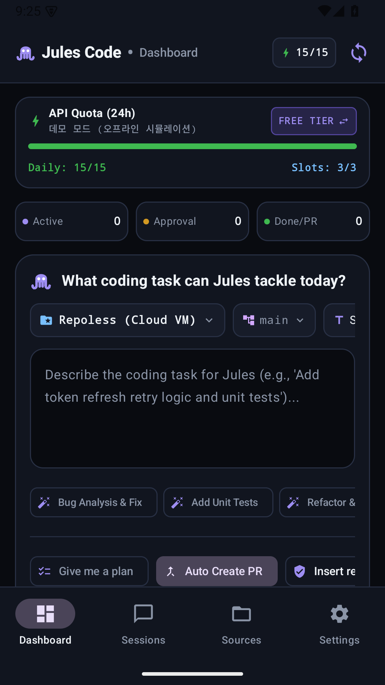
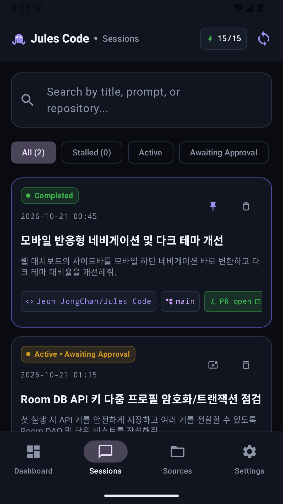
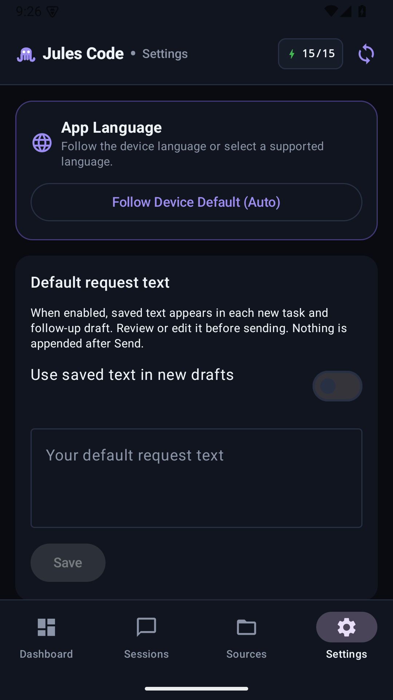
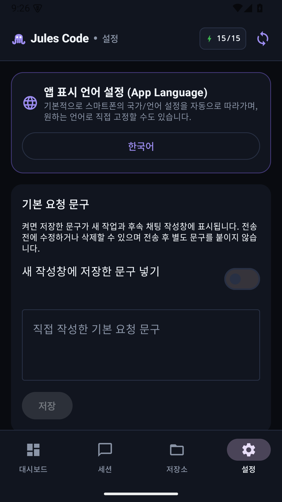
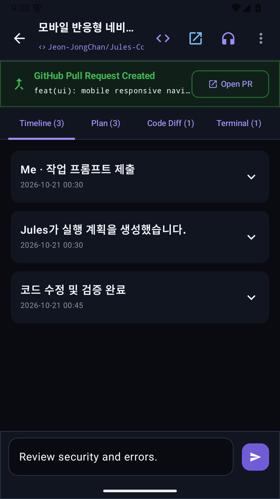
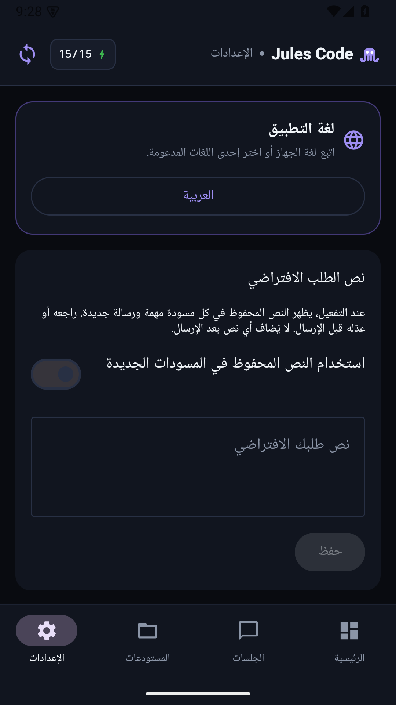

<div align="center">

# Jules Code

**스마트폰에서 Jules 코딩 작업을 시작하고, 계획·대화·코드 변경을 확인하세요.**<br>
(Start Jules coding tasks from your phone and review plans, conversations, and code changes.)

Google Jules REST API를 사용하는 비공식 Android 클라이언트입니다.<br>
(An unofficial Android client for the Google Jules REST API.)

[주요 기능](#주요-기능-features) · [화면](#화면-screenshots) · [시작하기](#시작하기-getting-started) · [언어](#언어-languages) · [직접 빌드](#직접-빌드-build-from-source)<br>
([Features](#주요-기능-features) · [Screenshots](#화면-screenshots) · [Getting started](#시작하기-getting-started) · [Languages](#언어-languages) · [Build from source](#직접-빌드-build-from-source))

</div>

## 왜 유용한가요? (Why use Jules Code?)

자리를 비운 동안에도 작업을 맡기고, 계획을 승인하고, 에이전트에게 수정 사항을 전달할 수 있습니다. 긴 로그와 코드 차이를 모바일에서 나눠 읽고, 여러 API 키의 작업을 오가며 진행 상황을 확인합니다.<br>
(Assign tasks, approve plans, and send revisions to the agent while you are away from your desk. Read long logs and diffs in manageable sections on mobile, and switch between API key profiles to check progress.)

API 키가 없어도 데모로 화면과 작업 흐름을 먼저 살펴볼 수 있습니다.<br>
(Explore the screens and workflow in demo mode without an API key.)

## 화면 (Screenshots)

1.3.0 디버그 빌드를 Android 15(API 35) 전용 에뮬레이터에서 직접 실행한 화면입니다. 세션·저장소·대화 내용은 오프라인 데모 데이터입니다.<br>
(Captured directly from the 1.3.0 debug build running on a dedicated Android 15 / API 35 emulator. Sessions, repositories, and conversations contain offline demo data.)

| 작업 작성<br>(Task composer) | 세션 목록<br>(Session list) |
|---|---|
|  |  |
| **기본 요청 문구 설정**<br>(Default request text settings) | **한국어 설정**<br>(Settings in Korean) |
|  |  |

<details>
<summary>세션 타임라인과 아랍어 화면 보기 (View the session timeline and Arabic interface)</summary>

| 타임라인과 후속 초안<br>(Timeline and follow-up draft) | 아랍어 RTL<br>(Arabic RTL) |
|---|---|
|  |  |

</details>

## 주요 기능 (Features)

| 기능<br>(Feature) | 어떻게 도움이 되나요?<br>(How does it help?) |
|---|---|
| 작업 시작<br>(Start tasks) | 연결된 저장소와 브랜치를 선택하고 작업을 요청합니다. 저장소 없는 작업도 지원합니다.<br>(Choose a connected repository and branch, then submit a task. Tasks without a repository are also supported.) |
| 계획 승인과 후속 대화<br>(Plan approval and follow-up chat) | 실행 계획을 확인하고 승인하거나 추가 지시를 보냅니다.<br>(Review and approve execution plans, or send additional instructions.) |
| 활동 타임라인<br>(Activity timeline) | 사용자 메시지와 에이전트 진행 상황을 시간순으로 확인합니다.<br>(Follow user messages and agent progress in chronological order.) |
| 코드·터미널·미디어 보기<br>(Code, terminal, and media viewer) | 변경 파일, 패치, 명령 출력과 실제 API 첨부를 확인합니다. 긴 글은 구간별로 읽고 복사합니다.<br>(Inspect changed files, patches, command output, and attachments returned by the API. Read and copy long content in sections.) |
| 여러 API 키<br>(Multiple API keys) | 프로필별로 키를 저장·전환하고 마지막 동기화 상태를 확인합니다.<br>(Save and switch API key profiles, and check their latest sync status.) |
| 이용량 보기<br>(Usage estimates) | 최근 24시간의 조회된 세션과 선택한 요금제 기준으로 남은 작업량을 추정합니다. 서버의 청구·사용량 원장과 동일한 값은 아닙니다.<br>(Estimate remaining capacity from retrieved sessions in the past 24 hours and the selected plan. These estimates are separate from the server's billing and usage records.) |
| 재사용 템플릿<br>(Reusable templates) | 자주 쓰는 작업 설명을 저장하고 작성창에 불러옵니다.<br>(Save frequently used task descriptions and load them into the composer.) |
| 기본 요청 문구<br>(Default request text) | 직접 저장하고 활성화한 문구를 새 작업·후속 채팅 작성창에 미리 넣습니다. 전송 전에 수정하거나 삭제할 수 있습니다.<br>(Prepopulate new task and follow-up drafts with text you explicitly save and enable. Edit or remove it before sending.) |
| 직접 삽입하는 요청<br>(Explicit instruction insertion) | 검토·CI·모델 선호·저장소 노트를 버튼으로 작성창에 넣습니다. 서버 기능을 켜는 스위치가 아니라 실제 본문에 보이는 요청입니다.<br>(Use buttons to insert review requests, CI instructions, model preferences, and repository notes into the composer. These are visible instructions in the message body rather than server feature switches.) |
| 지연 진단<br>(Stall diagnostics) | 오랫동안 활동이 없거나 답변이 없는 세션을 구분해 보여주고 재촉·재시작을 돕습니다.<br>(Identify sessions with prolonged inactivity or unanswered messages, with options to nudge or restart them.) |
| 오디오 요약<br>(Audio summaries) | 기기의 TTS 엔진으로 세션 요약을 들을 수 있습니다. 음성 제공 여부는 기기와 설치된 엔진에 따라 달라집니다.<br>(Listen to session summaries through your device's text-to-speech engine. Voice availability depends on the device and installed engine.) |
| 오프라인 데모<br>(Offline demo) | 실제 키를 등록하기 전에 작업 시작·계획·대화·코드 보기 흐름을 체험합니다.<br>(Explore task creation, plans, conversations, and code views before registering a real API key.) |

**전송 원칙:** 작성창에 보이는 최종 본문을 그대로 보냅니다. 앱 표시 언어가 에이전트의 답변 언어를 정하지 않으며, 전송 시점에 숨은 언어·모델·미디어 지시를 추가하지 않습니다. 모델 선호 문장을 적어도 실제 모델 선택 가능 여부는 Jules가 결정합니다.<br>
(**Sending policy:** The final text visible in the composer is sent as written. The app's display language does not determine the agent's reply language, and no hidden language, model, or media instructions are added when sending. Jules determines whether a requested model preference can be honored.)

## 시작하기 (Getting started)

1. 이 저장소의 Releases에서 배포 APK를 받아 설치합니다. 새 배포가 없다면 아래 방법으로 직접 빌드합니다.<br>
   (Download and install an APK from this repository's Releases. If no release is available, build it from source using the instructions below.)

2. Jules 웹 설정에서 API 키를 발급받습니다: [jules.google.com/settings](https://jules.google.com/settings).<br>
   (Create an API key in the [Jules web settings](https://jules.google.com/settings).)

3. 앱에 키를 입력하고 프로필을 저장합니다. 키 없이 둘러보려면 **데모 모드**를 선택합니다.<br>
   (Enter the key in the app and save your profile. Choose **demo mode** to explore without a key.)

4. 작업 설명과 저장소·브랜치를 선택합니다. 필요하면 계획 승인을 켜고 시작합니다.<br>
   (Enter a task description and select a repository and branch. Enable plan approval if needed, then start the task.)

5. 세션을 열어 계획을 승인하거나, 후속 채팅과 변경 내용을 확인합니다.<br>
   (Open the session to approve its plan, send follow-up messages, and review changes.)

기본 요청 문구는 **설정 → 기본 요청 문구**에서 직접 작성·저장한 뒤 켭니다. 사용 중인 초안은 설정 변경으로 덮어쓰지 않으며, 새 초안에 저장된 문구를 적용합니다.<br>
(Write and save your text under **Settings → Default request text**, then enable it. Settings changes leave existing drafts intact; saved text is applied to new drafts.)

## 언어 (Languages)

| 언어<br>(Language) | 표시<br>(Display name) |
|---|---|
| 한국어<br>(Korean) | 한국어<br>(Korean) |
| 영어<br>(English) | English |
| 스페인어<br>(Spanish) | Español |
| 일본어<br>(Japanese) | 日本語 |
| 포르투갈어<br>(Portuguese) | Português |
| 프랑스어<br>(French) | Français |
| 독일어<br>(German) | Deutsch |
| 중국어 간체<br>(Simplified Chinese) | 简体中文 |
| 힌디어<br>(Hindi) | हिन्दी |
| 아랍어<br>(Arabic) | العربية |
| 러시아어<br>(Russian) | Русский |
| 인도네시아어<br>(Indonesian) | Bahasa Indonesia |

기본 설정은 기기 언어를 따르며 지원하지 않는 언어는 영어로 표시합니다. 앱 안에서 수동으로 선택할 수 있고 아랍어는 오른쪽에서 왼쪽으로 표시합니다. 사용자·에이전트가 작성한 실제 대화와 코드·서버 오류 본문은 자동 번역하지 않습니다.<br>
(The app follows your device language by default and falls back to English for unsupported languages. You can select a language in the app; Arabic uses a right-to-left layout. User and agent conversations, code, and server error messages are not automatically translated.)

## Android 호환성 (Android compatibility)

최소 Android 5.0(API 21), 대상 Android 16(API 36)으로 설정했습니다. 날짜 API의 하위 버전 지원과 구형 런처 아이콘을 포함합니다. 기기 제조사별 동작과 지원 음성·영상 코덱은 다를 수 있습니다.<br>
(The minimum supported version is Android 5.0 / API 21, targeting Android 16 / API 36. Compatibility support includes date APIs on older versions and legacy launcher icons. Behavior and supported audio and video codecs may vary by device manufacturer.)

| 검증 환경<br>(Test environment) | 확인한 범위<br>(Verified scope) |
|---|---|
| Android 5.0(API 21), 에뮬레이터<br>(Android 5.0 / API 21 emulator) | 설치·온보딩·Room 데모 데이터 생성·세션 타임라인<br>(Installation, onboarding, Room demo data creation, and session timeline) |
| Android 15(API 35), 에뮬레이터<br>(Android 15 / API 35 emulator) | 설치·온보딩·데모·세션 타임라인·기본 문구 저장과 작성창 표시<br>(Installation, onboarding, demo mode, session timeline, and saving and displaying default request text) |
| 12개 언어<br>(12 languages) | 실제 설정 메뉴 전환, 기기 언어 복귀, 아랍어 RTL 배치<br>(Language switching in settings, returning to the device language, and Arabic RTL layout) |
| 360dp 화면, 글꼴 130%, 가로 화면<br>(360dp width, 130% font size, and landscape orientation) | 메뉴 접근, 화면 회전 후 탭과 작성 중인 요청 복원<br>(Menu access and restoration of the selected tab and draft after rotation) |

회귀 테스트 15개와 언어 리소스 검사를 통과했습니다. Android Lint는 오류 0개이며 개선 경고가 남아 있습니다. 실제 제조사 기기와 실제 API 키를 사용하는 온라인 작업은 이 검증 범위에 포함되지 않습니다.<br>
(All 15 regression tests and the language resource check passed. Android Lint reported zero errors, with improvement warnings remaining. This validation does not cover physical devices from manufacturers or online tasks using a real API key.)

[Android 5.0 실제 실행 화면](assets/screenshots/release-20261110/08_session_api21_en.png)에서 하위 버전의 타임라인 표시를 확인할 수 있습니다.<br>
(See the [actual Android 5.0 screenshot](assets/screenshots/release-20261110/08_session_api21_en.png) for the timeline running on an older Android version.)

## 앱과 웹의 역할 (App and web responsibilities)

앱은 API가 제공하는 작업 생성·조회·삭제·계획 승인·메시지 전송을 사용합니다. 자동 예약, 저장소 VM 설정, 일시 중지·재개와 일부 수동 게시 작업은 Jules 웹에서 관리합니다. 저장소 노트는 웹 VM 설정 자체를 변경하지 않습니다.<br>
(The app uses the API to create, retrieve, and delete tasks, approve plans, and send messages. Manage scheduling, repository VM settings, pause and resume actions, and some manual publishing operations on the Jules website. Repository notes do not change the web VM configuration.)

API 키는 앱의 로컬 데이터베이스에 저장됩니다. 앱은 Google OAuth 로그인을 제공하지 않습니다. 데모의 저장소·대화·PR은 예시 데이터입니다.<br>
(API keys are stored in the app's local database. The app does not offer Google OAuth sign-in. Demo repositories, conversations, and pull requests are sample data.)

## 직접 빌드 (Build from source)

필요한 환경은 JDK 21과 Android SDK입니다. Windows에서는 프로젝트 내부의 포터블 실행 스크립트를 사용할 수 있습니다.<br>
(JDK 21 and the Android SDK are required. On Windows, you can use the portable launcher included in the project.)

```powershell
# 최초 설치: Android 라이선스 확인 후 동의
# (First-time setup: review and accept the Android licenses.)
powershell -ExecutionPolicy Bypass -File .\.tools\.build\kotlin.ps1 -Action install -AndroidApi 36 -BuildTools 36.0.0 -WithAdb -AcceptAndroidLicenses

# 현재 세션에 도구 경로 적용
# (Apply tool paths to the current shell session.)
. .\.tools\.build\kotlin.ps1 -Action env

# 빌드
# (Build the app.)
.\gradlew.bat assembleDebug assembleRelease

# 회귀 검사
# (Run regression checks.)
.\gradlew.bat testDebugUnitTest lintDebug
python .tools/.test/localization_check.py
```

APK는 `.tools/build/app/outputs/apk/`에 생성됩니다. 빌드·캐시·검증 로그·테스트 전용 파일은 `.tools/` 아래에 모읍니다. 앱 소스는 `app/src/main/`, README용 이미지는 `assets/screenshots/`에 있습니다.<br>
(APKs are generated under `.tools/build/app/outputs/apk/`. Build outputs, caches, validation logs, and test-only files stay under `.tools/`. App sources are in `app/src/main/`, and README images are in `assets/screenshots/`.)

릴리스 서명은 기존 키를 유지해야 같은 앱의 업데이트로 설치할 수 있습니다. 별도 키를 쓰려면 `JULES_KEYSTORE_PATH`, `JULES_KEYSTORE_PASSWORD`, `JULES_KEY_ALIAS`, `JULES_KEY_PASSWORD` 환경변수를 설정합니다. 키 파일을 저장소에 올리지 마세요.<br>
(Keep the existing release signing key so new versions can be installed as updates to the same app. To use a different key, set `JULES_KEYSTORE_PATH`, `JULES_KEYSTORE_PASSWORD`, `JULES_KEY_ALIAS`, and `JULES_KEY_PASSWORD`. Do not commit key files to the repository.)

## 코드 읽기 (Code guide)

- `MainActivity`: 앱 진입, 화면 전환과 딥링크.<br>
  (`MainActivity`: App entry, navigation, and deep links.)

- `JulesViewModel`: 화면 상태와 작업 흐름 조정.<br>
  (`JulesViewModel`: UI state and task workflow coordination.)

- `SessionTimelineStore`: 활동 캐시·미반영 메시지·삭제 후 늦은 응답 처리.<br>
  (`SessionTimelineStore`: Activity caching, pending messages, and late responses after deletion.)

- `JulesLocaleManager`, `UiText`, `SessionHealthText`: 언어 해석과 표시 문구.<br>
  (`JulesLocaleManager`, `UiText`, `SessionHealthText`: Locale resolution and display text.)

- `JulesApiClient`: HTTP 요청, 페이지 조회, 큰 활동·첨부의 파일 처리.<br>
  (`JulesApiClient`: HTTP requests, pagination, and file handling for large activity content and attachments.)

- `JulesDatabase`: 키 프로필과 세션·저장소·템플릿의 로컬 저장.<br>
  (`JulesDatabase`: Local storage for key profiles, sessions, repositories, and templates.)

용어는 [GLOSSARY.md](GLOSSARY.md)에 정리했습니다.<br>
(Project terminology is documented in [GLOSSARY.md](GLOSSARY.md).)

## 문제 해결과 기여 (Troubleshooting and contributing)

오류를 제보할 때 Android 버전, 기종, 앱 버전과 재현 순서를 적어 주세요. API 키와 개인 저장소 정보는 지운 뒤 로그·화면을 공유해 주세요. 번역 수정 시에는 문자열 키와 `%1$s`, `%1$d` 같은 서식 인자를 유지해 주세요.<br>
(When reporting an issue, include the Android version, device model, app version, and reproduction steps. Remove API keys and private repository information before sharing logs or screenshots. When editing translations, preserve string keys and format arguments such as `%1$s` and `%1$d`.)

문서 구성은 [Immich](https://github.com/immich-app/immich)와 [Readest](https://github.com/readest/readest)의 화면·기능·시작하기 흐름을 참고했으며 설명은 이 앱의 실제 기능을 기준으로 작성했습니다.<br>
(The screenshot, feature, and getting-started structure was inspired by [Immich](https://github.com/immich-app/immich) and [Readest](https://github.com/readest/readest). Descriptions reflect this app's actual features.)

## 📄 라이선스 (License)

본 프로젝트는 [Apache License 2.0](LICENSE) 라이선스를 따릅니다. 누구나 자유롭게 코드를 확인하고, 수정하며, 재배포할 수 있습니다.<br>
*(This project is distributed under the terms of the Apache License 2.0. Feel free to inspect, modify, and distribute.)*

```text
Copyright 2026 Jules Code App Contributors

Licensed under the Apache License, Version 2.0 (the "License");
you may not use this file except in compliance with the License.
You may obtain a copy of the License at

    http://www.apache.org/licenses/LICENSE-2.0

Unless required by applicable law or agreed to in writing, software
distributed under the License is distributed on an "AS IS" BASIS,
WITHOUT WARRANTIES OR CONDITIONS OF ANY KIND, either express or implied.
See the License for the specific language governing permissions and
limitations under the License.
```
