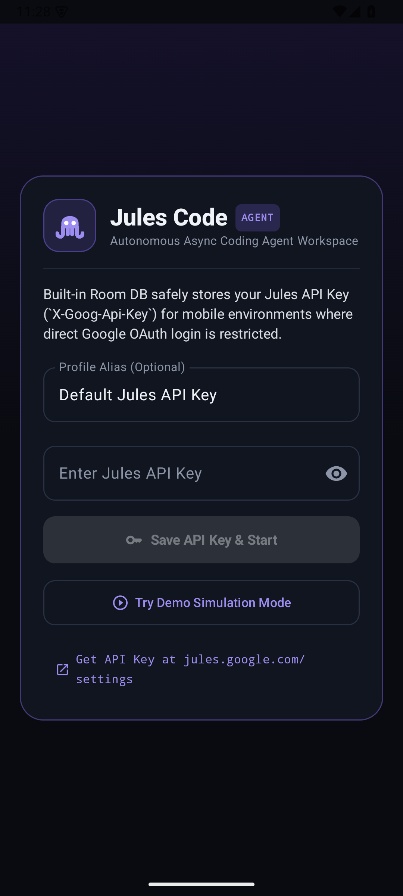
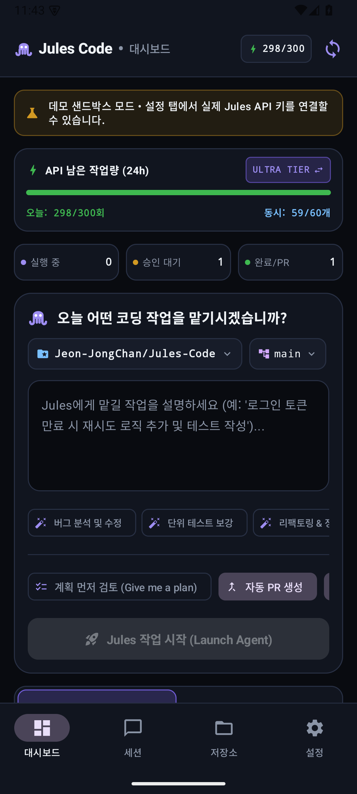
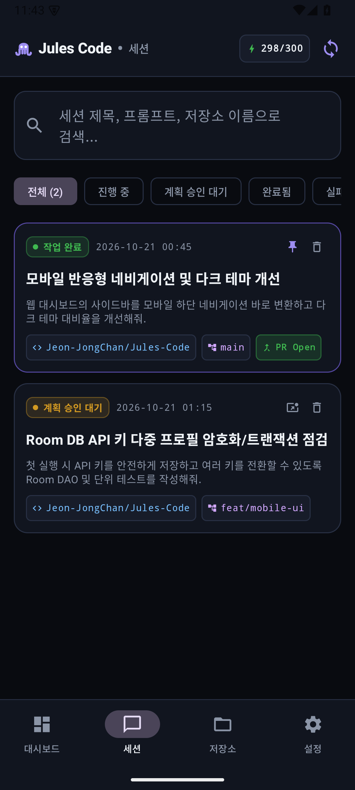
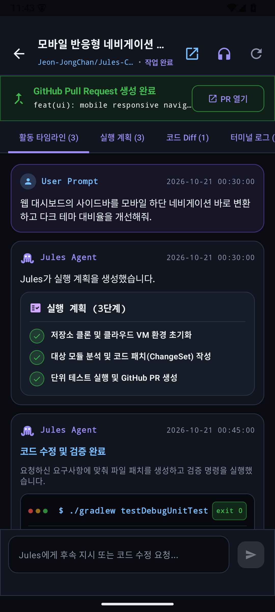
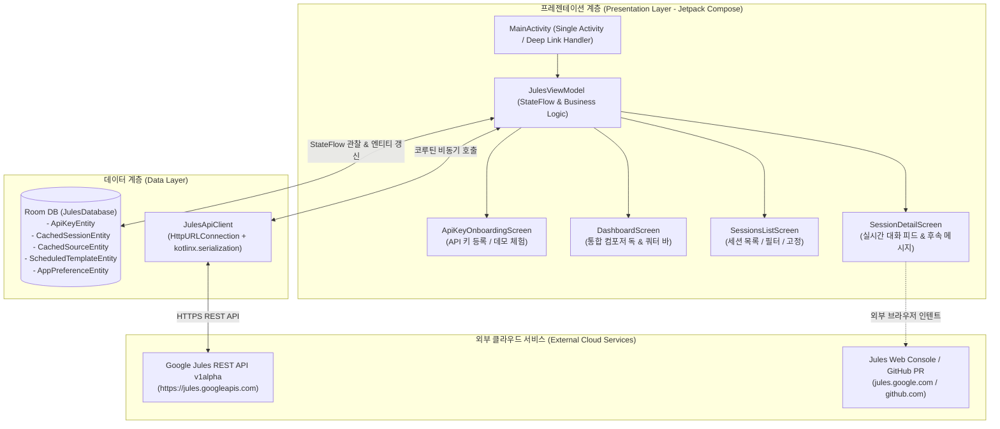

<div align="center">

# 🐙 Jules Code (Android)
**Google Jules 공식 REST API 기반 자율형 코딩 에이전트 모바일 클라이언트**  
*(Autonomous Coding Agent Mobile Client powered by Google Jules official REST API)*

[-3DDC84.svg?style=for-the-badge&logo=android&logoColor=white)](https://android.com)
[](https://kotlinlang.org)
[](https://developer.android.com/jetpack/compose)
[](https://m3.material.io)
[](https://developer.android.com/training/data-storage/room)
[](LICENSE)

<br/>

**Jules Code**는 Google의 차세대 AI 자율 코딩 에이전트 서비스 [Google Jules](https://jules.google.com)를 안드로이드 스마트폰과 태블릿에서 완벽하게 제어할 수 있는 네이티브 모바일 애플리케이션입니다.  
*(**Jules Code** is a native Android mobile application designed to seamlessly interact with and monitor [Google Jules](https://jules.google.com), Google's next-generation autonomous AI coding agent, directly from smartphones and tablets.)*

언제 어디서나 스마트폰으로 GitHub 저장소를 연결하고, 이슈 해결을 지시하며, 에이전트와 대화하고, 제안된 계획을 검토하여 Pull Request 생성을 승인할 수 있습니다.  
*(Assign coding tasks to connected GitHub repositories, chat directly with the agent, review proposed implementation plans, and approve pull requests anytime, anywhere.)*

</div>

---

## 📸 스크린샷 갤러리 (Screenshots Gallery)

실제 최신 빌드 Android 에뮬레이터 환경에서 구동된 Jules Code의 핵심 화면입니다.  
*(Actual captured screenshots of Jules Code running the latest build on an Android emulator environment.)*

<table>
  <tr>
    <td align="center" width="25%">
      <br/>
      <b>01. 온보딩 & 키 등록</b><br/>
      <i>(Onboarding & Key Vault)</i><br/>
      <sub>Room DB 기반 API 키 등록 및 오프라인 데모 모드 지원<br/>(Local Room DB vault & instant demo mode)</sub>
    </td>
    <td align="center" width="25%">
      <br/>
      <b>02. 대시보드 & 컴포저</b><br/>
      <i>(Dashboard & Composer Dock)</i><br/>
      <sub>24시간 롤링 쿼터 트래커 및 원터치 프롬프트 제안 칩<br/>(24h rolling quota tracker & quick suggestion chips)</sub>
    </td>
    <td align="center" width="25%">
      <br/>
      <b>03. 세션 목록 & 필터</b><br/>
      <i>(Sessions Directory & Filter)</i><br/>
      <sub>상태별 필터 칩, 세션 핀 고정 및 검색<br/>(State filter chips, pin-to-top & keyword search)</sub>
    </td>
    <td align="center" width="25%">
      <br/>
      <b>04. 세션 대화 & 채팅</b><br/>
      <i>(Session Chat & Live Feed)</i><br/>
      <sub>사용자-에이전트 실시간 채팅, 계획 승인 배너 및 후속 지시 입력<br/>(Interactive agent chat, plan approval & follow-up prompt dock)</sub>
    </td>
  </tr>
</table>

---

## ✨ 핵심 기능 (Key Features)

### 1. 실시간 대화 & 세션 채팅 인터페이스 (Interactive Session Chat Interface)
- **에이전트와의 실시간 상호작용 (Live Agent-User Conversation)**: 사용자 프롬프트와 Jules 에이전트의 사고 과정, 계획 생성 로그, 진행률(`progressUpdated`)을 직관적인 채팅 피드 형태로 모니터링합니다. *(Monitor user prompts, agent reasoning, plan generation, and live progress updates in an intuitive chat feed.)*
- **실시간 후속 메시지 전송 (Instant Follow-up Prompting)**: 작업 진행 중 언제든지 하단 메시지 입력창을 통해 추가 지시나 수정 피드백을 전달(`POST :sendMessage`)할 수 있습니다. *(Dispatch real-time follow-up instructions or refinement requests directly through the bottom input dock.)*
- **계획 검토 및 원터치 승인 (Plan Review & One-Tap Approval)**: 에이전트가 도출한 단계별 작업 계획을 검토하고 모바일에서 즉시 승인(`POST :approvePlan`)하여 코드 구현을 시작합니다. *(Review step-by-step execution plans proposed by the agent and approve them with a single tap to initiate code writing.)*

### 2. Google Jules v1alpha REST API 풀 스택 연동 (Full Google Jules v1alpha REST API Support)
- **저장소 및 브랜치 동기화 (Repository & Branch Sync)**: Google Jules에 연결된 GitHub 소스(`GET /v1alpha/sources`)와 활성 브랜치를 실시간으로 가져옵니다. *(Fetch connected GitHub sources and active branch lists in real time via official endpoints.)*
- **자율 코딩 세션 생성 (Session Creation & Automation)**: 대상 저장소, 시작 브랜치, 계획 승인 필수 여부(`requirePlanApproval`), 자동 PR 생성 옵션을 지정하여 새로운 작업을 시작합니다. *(Launch sessions with custom branches, plan approval enforcement, and automated PR creation.)*
- **Unified Diff & 터미널 로그 (Unified Diff & Terminal Logs)**: 파일별 코드 변경점과 클라우드 VM 콘솔 출력(Bash 로그)을 모바일 다크 모드 화면에서 상세하게 검토합니다. *(Inspect file diff syntax highlighting and cloud VM Bash execution logs directly on mobile.)*
- **TTS 오디오 체인지로그 브리핑 (Audio TTS Changelog Briefing)**: Android 내장 TextToSpeech 엔진을 통해 에이전트의 활동 요약 및 변경 내역을 음성으로 브리핑받을 수 있습니다. *(Listen to voice summaries of session changelogs and activities powered by Android's native TextToSpeech engine.)*

### 3. 모바일 친화적 인증 & 오프라인 데모 모드 (Mobile-First Authentication & Offline Demo)
- **Room DB 기반 안전한 로컬 키 저장 (Encrypted Local Storage via Room DB)**: 복잡한 웹 OAuth 대신 `X-Goog-Api-Key`를 기기 내 SQLite Room 데이터베이스에 안전하게 보관합니다. *(Securely stores `X-Goog-Api-Key` credentials directly inside local SQLite via Room DB without web OAuth complexities.)*
- **다중 프로필 원터치 전환 (Multi-Profile Instant Switching)**: 개인용/업무용 등 여러 개의 API 키를 라벨별로 관리하고 탭 한 번으로 전환합니다. *(Organize multiple API keys with custom labels and toggle between them instantly.)*
- **100% 오프라인 데모 시뮬레이션 (Full Offline Demo Simulation Mode)**: API 키가 없는 사용자도 모든 화면 구성, 대시보드 컴포저, 실시간 채팅, 가상 세션 실행을 즉시 체험할 수 있습니다. *(Experience the complete UI, dashboard composer, live chat feed, and simulated sessions without requiring an actual API key.)*

### 4. 롤링 24시간 쿼터 트래커 (Rolling 24-Hour Quota Tracker)
- **공식 롤링 윈도우 기준 실시간 분석 (Real-time Analysis based on 24h Rolling Window)**: 최근 24시간 동안 시작된 세션 타임스탬프를 정밀 계산하여 남은 일일 작업 횟수와 활성 동시 슬롯을 산출합니다. *(Calculates remaining daily sessions and concurrent execution slots based on session timestamps within the last 24 hours.)*
- **티어별 한도 자동 반영 (Tier Limit Presets)**: `FREE` (일 15회 / 동시 3개), `PRO` (일 100회 / 동시 15개), `ULTRA` (일 300회 / 동시 60개) 한도 지원 및 실시간 프로그레스 바 제공. *(Presets for Free, Pro, and Ultra tiers with interactive status badges and progress indicators.)*

---

## 🏛️ 시스템 아키텍처 (System Architecture)



---

## 🛠️ 기술 스택 (Tech Stack)

| 구분 (Category) | 사용 기술 (Technologies Used) | 설명 (Description) |
|---|---|---|
| **언어 (Language)** | **Kotlin 2.0.21** | 모던 함수형 프로그래밍 및 타입 안전성 확보 *(Modern functional programming & type safety)* |
| **UI 프레임워크 (UI)** | **Jetpack Compose (BOM 2024.10.01)** | 선언형 UI 렌더링 및 반응형 상태 바인딩 *(Declarative reactive UI rendering)* |
| **디자인 시스템 (Design)** | **Material 3 (M3 Expressive Dark)** | 다크 옵시디언 테마 및 반응형 서피스 디자인 *(Obsidian Dark theme & responsive surface design)* |
| **아키텍처 (Architecture)** | **MVVM + Single Activity** | 클린 아키텍처 기반 관심사 분리 *(Clean separation of concerns with AndroidX ViewModel)* |
| **로컬 스토리지 (Storage)** | **Room DB 2.6.1 (SQLite)** | API 키, 캐시된 세션, 저장소 및 템플릿 영구 보관 *(Persistent local database via Room)* |
| **비동기 & 스트림 (Async)** | **Kotlin Coroutines & Flow** | 논블로킹 네트워크 I/O 및 반응형 상태 전파 *(Non-blocking concurrency & reactive streams)* |
| **네트워킹 (Networking)** | **Standard `HttpURLConnection`** | 외부 무거운 의존성을 배제한 가벼운 네이티브 통신 *(Ultra-lightweight stdlib HTTP client)* |
| **직렬화 (Serialization)** | **`kotlinx.serialization` (JSON)** | 유연한 필드 파싱 및 고성능 JSON 디코딩 *(High-performance flexible JSON parsing)* |
| **빌드 툴체인 (Build System)** | **Gradle 8.10 + AGP 8.7.0 + KSP** | 최신 안드로이드 빌드 파이프라인 *(Modern Android build pipeline)* |

---

## 📂 프로젝트 구조 (Project Directory Structure)

```text
Jules Code App/
├── .build/                             # 격리형 포터블 빌드 킷 (JDK 21, Android SDK, Gradle 캐시)
│   ├── kotlin.ps1                      # 포터블 개발 환경 통합 제어 PowerShell 스크립트
│   └── test/                           # 테스트 및 자동화 검증 도구 모음
│       ├── run_tests.ps1               # 단위/계측 테스트 통합 실행 스크립트
│       ├── capture_and_ocr.py          # 에뮬레이터 화면 캡처 및 OCR 파이프라인
│       ├── capture_hierarchy.py        # UI 컴포넌트 계층 덤프 도구
│       └── README.md                   # 테스트 스크립트 가이드
├── assets/
│   └── screenshots/                    # 에뮬레이터에서 직접 캡처한 최신 UI 실기 스크린샷 4종
│       ├── 01_onboarding.png           # 온보딩 및 API 키 등록 화면
│       ├── 02_dashboard.png            # 메인 대시보드 & 컴포저 독
│       ├── 03_sessions_list.png        # 세션 목록 및 필터링 화면
│       └── 04_session_chat.png          # 세션 실시간 채팅 & 대화 화면
├── app/
│   ├── build.gradle.kts                # 의존성, SDK 버전(API 35), Room KSP 설정
│   └── src/
│       ├── androidTest/                # 에뮬레이터/실기기 대상 E2E UI 계측 테스트
│       │   └── java/com/jules/code/JulesInstrumentedTest.kt
│       ├── test/                       # 로컬 JVM 기반 단위 테스트
│       │   └── java/com/jules/code/JulesApiParserTest.kt # API 파서, 시간순 정렬 및 외부 소스 단위 테스트
│       └── main/
│           ├── AndroidManifest.xml     # 앱 권한, 인텐트 필터, 브라우저 연동 패키지 가시성(queries)
│           ├── java/com/jules/code/
│           │   ├── MainActivity.kt     # 루트 액티비티, 딥링크 파싱 및 4탭 네비게이션 쉘
│           │   ├── data/
│           │   │   ├── local/          # Room DB 엔티티, DAO, 인스턴스 (JulesDatabase.kt)
│           │   │   ├── model/          # 직렬화 모델 및 소스/타임스탬프 파서 (JulesModels.kt)
│           │   │   └── remote/         # REST API 통신 엔진 (JulesApiClient.kt)
│           │   └── ui/
│           │       ├── JulesViewModel.kt # 전역 상태 Flow, 비즈니스 로직, 쿼터 계산기, 외부 소스 관리
│           │       ├── JulesBrowserUtils.kt # 기본 브라우저 실행 및 GitHub 연동 유틸리티
│           │       ├── JulesLocalization.kt # 앱 다국어(한국어/영어/시스템) 로케일 매니저
│           │       ├── screens/        # 화면 컴포저블 모음
│           │       │   ├── DashboardAndOnboardingScreens.kt # 대시보드 컴포저 독 및 온보딩
│           │       │   ├── SessionDetailScreen.kt           # 실시간 채팅 피드, 계획 승인, 이미지 줌, 코드 Diff
│           │       │   └── SessionsSourcesSettingsScreens.kt# 세션 목록, 외부 저장소 관리, 설정
│           │       └── theme/          # Jules 고유 보라빛 옵시디언 테마 및 벡터 엠블럼 (JulesTheme.kt)
│           └── res/                    # Adaptive Vector App Icon, 다국어 문자열 리소스
├── build.gradle.kts                    # 최상위 루트 Gradle 빌드 스크립트
├── settings.gradle.kts                 # 모듈 및 플러그인 리포지토리 구성
└── README.md                           # 오픈소스 공식 프로젝트 안내 문서
```

---

## 🚀 빠른 시작 & 빌드 가이드 (Getting Started & Build Guide)

본 프로젝트는 호스트 운영체제에 Android Studio나 전역 JDK를 설치하지 않고도, 완전히 격리된 환경에서 빌드 및 테스트를 수행할 수 있는 **포터블 빌드 킷**(`.build/kotlin.ps1`)을 제공합니다.  
*(This project provides an isolated **portable build kit** (`.build/kotlin.ps1`), allowing you to build, test, and run without polluting host environments.)*

### 1. 포터블 개발 환경 설치 (최초 1회) (Install Portable Toolchain - Once)
PowerShell 콘솔을 열고 프로젝트 루트 경로에서 아래 명령을 실행합니다:  
*(Open PowerShell at the project root and execute the following command:)*

```powershell
# JDK 21, Android SDK (API 35, Build-Tools 35.0.0), ADB 격리 다운로드 및 라이선스 자동 동의
powershell -ExecutionPolicy Bypass -File .\.build\kotlin.ps1 -Action install -AndroidApi 35 -BuildTools 35.0.0 -WithAdb -AcceptAndroidLicenses
```

### 2. 세션 환경변수 활성화 (Activate Session Environment)
빌드나 adb 명령을 실행할 터미널 세션에 포터블 환경을 로드합니다:  
*(Export portable paths and toolchains to the current terminal session:)*

```powershell
. .\.build\kotlin.ps1 -Action env
```

### 3. APK 빌드 (Build Debug / Release APK)
```powershell
# 디버그 APK 빌드 (Build Debug APK)
.\gradlew.bat assembleDebug

# 릴리즈 APK 빌드 (Build Release APK)
.\gradlew.bat assembleRelease

# 빌드 산출물 위치 (Build outputs directory):
# app/build/outputs/apk/debug/Jules Code-debug.apk
# app/build/outputs/apk/release/Jules Code.apk
```

### 4. 테스트 실행 (Run Tests)
```powershell
# 로컬 JVM 단위 테스트 실행 (Run local JVM unit tests)
.\gradlew.bat testDebugUnitTest

# 연결된 실기기 또는 에뮬레이터에서 E2E 계측 테스트 실행 (Run connected Android instrumented tests)
.\gradlew.bat connectedDebugAndroidTest
```

### 5. 에뮬레이터 생성 및 앱 실행 (Start Emulator & Run App)
```powershell
# 포터블 가상 기기(AVD) 다운로드 및 생성 (최초 1회)
.\.build\kotlin.ps1 -Action emulator-install -AndroidApi 35 -SysImgType google_apis -Arch x86_64 -AvdName JulesPixel

# 가상 기기 부팅 (Launch emulator)
.\.build\kotlin.ps1 -Action emulator-start -AvdName JulesPixel

# APK 설치 및 앱 시작 (Install APK and start main activity)
adb install -r "app\build\outputs\apk\debug\Jules Code-debug.apk"
adb shell am start -n com.jules.code/.MainActivity
```

---

## 🔑 Jules API 키 발급 및 등록 (API Key Setup)

1. [Google AI Studio](https://aistudio.google.com/) 또는 Google Jules 공식 관리 페이지에서 Jules 접근 권한이 부여된 API 키를 발급받습니다.  
   *(Generate an API key with Google Jules access privileges from Google AI Studio or Jules Console.)*
2. Jules Code 앱 실행 시 나타나는 **온보딩 화면**에서 발급받은 키(`AQ...` 또는 `AIza...`)를 입력하고 **"API 키 저장 및 시작하기"**를 누릅니다.  
   *(Input the key into the onboarding screen and tap "Save API Key and Start".)*
3. 키가 없더라도 **"API 키 없이 데모 시뮬레이션 모드로 체험"** 버튼을 클릭하면 실제와 동일한 모의 환경에서 앱의 모든 기능을 둘러볼 수 있습니다.  
   *(Click "Explore in Demo Simulation Mode" to evaluate all features with mock sessions without requiring an actual key.)*
4. 등록된 키는 **설정 탭(Settings Tab)**에서 언제든지 별칭 수정, 추가 등록, 활성 키 전환 및 안전한 삭제가 가능합니다.  
   *(Manage, toggle, or delete registered keys safely anytime via the Settings tab.)*

---

## 📄 라이선스 (License)

본 프로젝트는 [Apache License 2.0](LICENSE) 라이선스를 따릅니다. 누구나 자유롭게 코드를 확인하고, 수정하며, 재배포할 수 있습니다.  
*(This project is distributed under the terms of the Apache License 2.0. Feel free to inspect, modify, and distribute.)*

```text
Copyright 2026 Jules Code App Contributors

Licensed under the Apache License, Version 2.0 (the "License");
you may not use this file except in compliance with the License.
You may obtain a copy of the License at

    http://www.apache.org/licenses/LICENSE-2.0

Unless required by applicable law or agreed to in writing, software
distributed under the License is distributed on an "AS IS" BASIS,
WITHOUT WARRANTIES OR CONDITIONS OF ANY KIND, either express or implied.
See the License for the specific language governing permissions and
limitations under the License.
```
